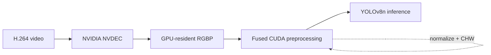
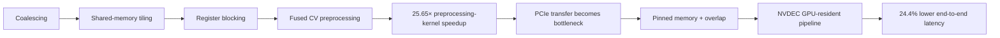

# GPUOpt

GPUOpt is a staged CUDA performance-engineering project that progresses from cache locality, memory coalescing, shared-memory tiling, and register blocking to a real GPU-resident YOLO inference pipeline.

The final system uses **NVIDIA NVDEC + GPU-resident RGBP + fused CUDA preprocessing** to reduce end-to-end latency by **24.4%** and increase throughput from **83.7 to 110.7 FPS** on an NVIDIA Tesla T4.

The central idea of the project is simple:

> **Optimizing the current bottleneck often reveals the next one.**

---

## Final architecture



## Bottleneck evolution



---

## Highlights

- CUDA memory coalescing: **~4.0×** speedup over strided access.
- Shared-memory tiling: another **~2.5×** improvement.
- Register-blocked GEMM: approximately **56% of cuBLAS** performance at 1024×1024.
- Real-video fused preprocessing: **3.18×** median speedup.
- YOLO preprocessing compute: **1.615 ms → 0.063 ms**, a **25.65× kernel-level speedup**.
- Stage 9 exposed PCIe HtoD transfer as the new bottleneck; end-to-end gain was only **1.002×**.
- Pinned memory reduced raw HtoD DMA latency by **2.23×**.
- Transfer/inference overlap improved **steady-state throughput by ~8.7%**.
- Final NVDEC pipeline: **11.9476 ms → 9.0324 ms** end-to-end latency.
- Final throughput: **83.70 → 110.71 FPS**.
- Final RGBP pipeline preserved **100/100 detection-count and class-sequence agreement**.

---

## Project progression

| Stage | Focus | Key result |
|---|---|---|
| [1](cpu/cpu_blocked.cpp) | CPU blocked matrix multiplication | Best block size reached ~7.86 GFLOP/s |
| [2](cuda/stage2_coalescing.cu) | CUDA memory coalescing | ~4.0× faster than strided global-memory access |
| [3](cuda/stage3_tiled.cu) | Shared-memory tiling | ~2.48× over coalesced baseline |
| [4](cuda/stage4_register_blocking.cu) | Register blocking | Higher arithmetic reuse with increased register pressure |
| [5](cuda/stage5_cublas_benchmark.cu) | cuBLAS comparison | ~56% of cuBLAS at 1024×1024 |
| [6](cuda/stage6_profiling/) | Nsight Compute profiling | Hardware counters blocked by Kaggle permissions |
| [7–8](cuda/stage7_8_fused_real_video/) | Fused CV + real-video preprocessing | 3.18× median speedup on 1920×1080 video |
| [9](cuda/stage9_yolo_integration/) | Real YOLO integration | 25.65× preprocessing-kernel speedup; PCIe became bottleneck |
| [10](cuda/stage10_gpu_resident_pipeline/) | GPU-resident NVDEC pipeline | **24.4% lower end-to-end latency; 83.7 → 110.7 FPS** |

---

## Stage 1 — CPU blocked matrix multiplication

Blocking improves cache reuse before moving to GPU-specific optimization.

| Block size | Time | Performance |
|---:|---:|---:|
| 16 | 443.9 ms | 4.84 GFLOP/s |
| 32 | 361.0 ms | 5.95 GFLOP/s |
| 64 | 273.4 ms | 7.86 GFLOP/s |

Source: [`cpu/cpu_blocked.cpp`](cpu/cpu_blocked.cpp)

---

## Stages 2–5 — GPU matrix-multiplication optimization

The CUDA GEMM experiments isolate progressively deeper optimization ideas:

1. **Coalescing** — adjacent threads access contiguous global memory.
2. **Shared-memory tiling** — reused matrix tiles reduce repeated global-memory loads.
3. **Register blocking** — each thread computes multiple outputs for higher arithmetic reuse.
4. **cuBLAS comparison** — the custom kernel is compared against a production library.

At 1024×1024, the register-blocked implementation sustained roughly **2872–2889 GFLOP/s** versus **4902–5140 GFLOP/s** for cuBLAS, reaching approximately **56% of cuBLAS performance**.

---

## Stage 6 — Profiling limitation

Nsight Compute was available, but Kaggle did not expose NVIDIA hardware performance counters:

```text
ERR_NVGPUCTRPERM
```

Profiler-dependent occupancy, cache, and warp-stall metrics were therefore **not inferred or fabricated**.

See [`cuda/stage6_profiling/`](cuda/stage6_profiling/).

---

## Stages 7–8 — Fused real-video preprocessing

The project then moved from synthetic GEMM to a practical CV workload.

A fused CUDA kernel combined preprocessing operations and avoided intermediate memory traffic. On a real **1920×1080 @ 50 FPS** boxing video:

| Pipeline | Median | p95 |
|---|---:|---:|
| Baseline | 0.1471 ms | 0.1564 ms |
| Fused | 0.0460 ms | 0.0513 ms |

Result: **3.18× median speedup**, with `max difference = 0.0`.

See [`cuda/stage7_8_fused_real_video/`](cuda/stage7_8_fused_real_video/).

---

## Stage 9 — Real YOLO integration and the PCIe bottleneck

Ultralytics' actual rectangular input for the video is **640×384** after resize and letterboxing. The custom CUDA kernel reproduces bilinear resize, padding, BGR→RGB, HWC→CHW, float conversion, and `/255` normalization.

Preprocessing correctness:

- Max absolute difference: **5.96e-08**
- Mean absolute difference: **1.25e-08**
- Detection counts matched on **100/100** frames

Performance:

| Path | Median |
|---|---:|
| Ultralytics preprocessing | 1.6152 ms |
| HtoD transfer only | 1.4866 ms |
| Fused CUDA kernel only | 0.0630 ms |
| HtoD + fused kernel | 1.6014 ms |

The kernel became **25.65× faster**, but full preprocessing improved only ~**1.01×**, and preprocessing + inference only **1.002×**.

The optimization had moved the bottleneck to transferring the full-resolution frame over PCIe.

See [`cuda/stage9_yolo_integration/`](cuda/stage9_yolo_integration/).

---

## Stage 10 — Removing the PCIe bottleneck

Stage 10 follows the bottleneck through several system-level experiments:

- **10A — Pinned memory:** raw DMA improved **2.23×**; real staged path improved **1.45×**.
- **10B — Transfer/inference overlap:** steady-state throughput improved from **101.99 to 110.87 FPS** (**~8.7%**). The reported `9.0194 ms/frame` is a **steady-state average throughput equivalent**, not the same metric as the final synchronous per-frame latency median.
- **10C — NVDEC:** H.264 video decode moved onto NVIDIA's hardware decoder.
- **10D — Direct NV12 fusion:** rejected after failing the correctness gate (**64/100** detection-count agreement).
- **10E — RGBP GPU-resident path:** passed the correctness gate with **100/100** detection-count and class-sequence agreement.
- **10F — Final apples-to-apples benchmark:** GPU-resident decode + preprocessing produced the real application-level improvement.

### Final benchmark

| Pipeline | Decode | Preprocess | Inference | Total | Throughput |
|---|---:|---:|---:|---:|---:|
| OpenCV / CPU | 1.7824 ms | 1.6755 ms | 8.4286 ms | **11.9476 ms** | **83.70 FPS** |
| NVDEC / GPU-resident | 0.2619 ms | 0.1319 ms | 8.6284 ms | **9.0324 ms** | **110.71 FPS** |

**Final system result:**

- **24.40% lower end-to-end latency**
- **1.323× end-to-end speedup**
- **83.70 → 110.71 FPS**
- full detection equivalence across the validation set

Implementation, benchmark scripts, results, diagrams, and reproduction instructions are in [`cuda/stage10_gpu_resident_pipeline/`](cuda/stage10_gpu_resident_pipeline/).

---

## Reproduce the project

The repo now includes stage runners under [`scripts/`](scripts/) and a detailed guide in [`REPRODUCING.md`](REPRODUCING.md).

Install the shared Python dependencies for the video/YOLO stages:

```bash
pip install -r requirements.txt
```

Run the standalone CPU/CUDA stages:

```bash
bash scripts/run_stage1.sh
bash scripts/run_stage2.sh
bash scripts/run_stage3.sh
bash scripts/run_stage4.sh
bash scripts/run_stage5.sh
```

Stage 6 requires Nsight Compute hardware-counter access:

```bash
bash scripts/run_stage6_ncu.sh
```

On Kaggle this is expected to fail with `ERR_NVGPUCTRPERM`; use a machine with performance counters enabled.

For the real-video stages, provide a **1920×1080 H.264 video**. The original benchmark video was 50 FPS:

```bash
bash scripts/run_stage7_8.sh /path/to/video.mp4
bash scripts/run_stage9.sh /path/to/video.mp4 yolov8n.pt
bash scripts/run_stage10.sh /path/to/video.mp4 yolov8n.pt
```

Or run the full sequence (Stage 6 excluded because profiler permissions are machine-dependent):

```bash
bash scripts/run_all.sh /path/to/video.mp4 yolov8n.pt
```

Reference results on the original Tesla T4 are documented in [`REPRODUCING.md`](REPRODUCING.md). Exact absolute timings can vary with GPU clocks, CUDA/driver versions, codec behavior, and system load.

---

## Hardware and environment

Experiments were primarily run on:

- NVIDIA Tesla T4
- CUDA Toolkit 12.8
- Driver 580.178.04
- PyTorch 2.11.0 + CUDA 12.8
- Ultralytics 8.4.183
- Nsight Compute 2025.1.1
- Kaggle GPU notebook

---

## Repository structure

```text
GPUOpt/
├── benchmarks/
├── cpu/
│   └── cpu_blocked.cpp
├── cuda/
│   ├── stage2_coalescing.cu
│   ├── stage3_tiled.cu
│   ├── stage4_register_blocking.cu
│   ├── stage5_cublas_benchmark.cu
│   ├── stage6_profiling/
│   ├── stage7_8_fused_real_video/
│   ├── stage9_yolo_integration/
│   └── stage10_gpu_resident_pipeline/
│       ├── benchmarks/
│       ├── kernels/
│       ├── results/
│       ├── scripts/
│       └── notebooks/
├── scripts/
│   ├── run_stage1.sh ... run_stage10.sh
│   └── run_all.sh
├── REPRODUCING.md
├── requirements.txt
└── README.md
```

---

## Current status

**Stages 1–10 are complete.**

The final pipeline uses NVDEC + GPU-resident RGBP + fused CUDA preprocessing, achieving **24.4% lower end-to-end latency** and **110.7 FPS** on the NVIDIA Tesla T4.