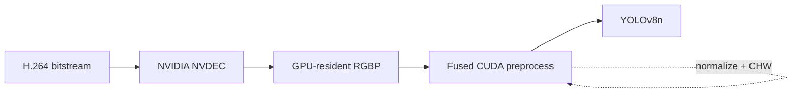

# Stage 10 — GPU-Resident YOLO Pipeline

Stage 9 made the preprocessing kernel **25.65× faster**, but end-to-end performance barely moved because transferring a full 1920×1080 BGR frame to the GPU cost about **1.49 ms/frame**. Stage 10 follows that bottleneck through pinned memory, overlap, and finally GPU-resident video decode.

## Final architecture



## Bottleneck evolution


## 10A — Pinned host memory

| Path | Median |
|---|---:|
| Pageable HtoD | 1.4709 ms |
| Pinned HtoD DMA | 0.6598 ms |
| CPU staging + pinned HtoD | 1.0113 ms |

- Raw DMA speedup: **2.23×**
- Real staged-path speedup: **1.45×**

Source: [`benchmarks/stage10a_pinned_memory.py`](benchmarks/stage10a_pinned_memory.py)

## 10B — Transfer / inference overlap

Double buffering and separate CUDA streams overlap transfer of frame N+1 with inference of frame N.

| Pipeline | Measurement | Throughput |
|---|---:|---:|
| Sequential pinned | 9.8045 ms/frame median | 101.99 FPS |
| Overlapped | 9.0194 ms/frame steady-state average | 110.87 FPS |

The **8.7% gain is a steady-state throughput improvement**. The overlapped 9.0194 ms/frame value is not presented as the same kind of per-frame latency measurement as the final synchronous median benchmark.

Source: [`benchmarks/stage10b_overlap.py`](benchmarks/stage10b_overlap.py)

## 10C — NVDEC environment

The H.264 boxing video was decoded using NVIDIA NVDEC through PyNvVideoCodec. This keeps decoded frames on the GPU and removes full-resolution CPU→GPU frame transfer from the critical path.

Sources: [`benchmarks/stage10c_nvdec_environment.py`](benchmarks/stage10c_nvdec_environment.py), [`scripts/stage10c_nvdec_checks.sh`](scripts/stage10c_nvdec_checks.sh)

## 10D — Direct NV12 fusion attempt

A direct NV12 → YOLO CUDA path was implemented and tested, but failed the correctness gate:

- Detection-count agreement: **64/100**
- Class-sequence agreement: **40/100**
- Max box-coordinate difference: **476.34 px**

The experiment is retained because it documents a rejected optimization rather than hiding a failed path.

Sources: [`kernels/nv12_yolo_preprocess.cu`](kernels/nv12_yolo_preprocess.cu), [`benchmarks/stage10d_nv12_equivalence.py`](benchmarks/stage10d_nv12_equivalence.py)

## 10E — Validated GPU-resident RGBP path

PyNvVideoCodec was configured to emit GPU-resident planar RGB. The fused CUDA kernel performs bilinear resize, YOLO letterboxing, uint8→float32 conversion, normalization, and CHW output.

Correctness across 100 frames:

- Detection-count agreement: **100/100**
- Class-sequence agreement: **100/100**
- Max confidence difference: **2.74e-06**
- Max box-coordinate difference: **0.000214 px**
- Mean box-coordinate difference: **0.000005 px**

Sources: [`kernels/rgbp_yolo_preprocess.cu`](kernels/rgbp_yolo_preprocess.cu), [`benchmarks/stage10e_rgbp_equivalence.py`](benchmarks/stage10e_rgbp_equivalence.py)

## 10F — Final apples-to-apples benchmark

Both paths use the same video, YOLO model, frame count, and inference API.

| Pipeline | Decode | Preprocess | Inference | Total | Throughput |
|---|---:|---:|---:|---:|---:|
| OpenCV / CPU | 1.7824 ms | 1.6755 ms | 8.4286 ms | **11.9476 ms** | **83.70 FPS** |
| NVDEC / GPU-resident | 0.2619 ms | 0.1319 ms | 8.6284 ms | **9.0324 ms** | **110.71 FPS** |

Final result:

- **24.40% lower end-to-end latency**
- **1.323× end-to-end speedup**
- **83.70 → 110.71 FPS**
- full detection equivalence across the validation set

Source: [`benchmarks/stage10_final_pipeline.py`](benchmarks/stage10_final_pipeline.py)

## Recreate from scratch

### Requirements

The validated environment was:

- NVIDIA Tesla T4
- CUDA toolkit 12.8 / `nvcc`
- CUDA-enabled PyTorch 2.11.0+cu128
- Ultralytics 8.4.183
- PyNvVideoCodec
- OpenCV 4.14
- FFmpeg with NVIDIA hardware decode support

Install a CUDA-enabled PyTorch build appropriate for your machine first. Then install the remaining Python dependencies:

```bash
pip install -r cuda/stage10_gpu_resident_pipeline/requirements.txt
```

Check the environment:

```bash
python cuda/stage10_gpu_resident_pipeline/scripts/check_environment.py
```

Build the CUDA kernels:

```bash
bash cuda/stage10_gpu_resident_pipeline/scripts/build_cuda.sh
```

### Input workload

The published result used a real H.264 boxing video with:

```text
1920×1080
50 FPS
H.264
```

The final CUDA preprocessing kernel is validated for **1920×1080 input → 640×384 YOLO input**. The benchmark now accepts the video path as a command-line argument instead of relying on a Kaggle-specific hard-coded path.

### Run the final benchmark

```bash
python cuda/stage10_gpu_resident_pipeline/benchmarks/stage10_final_pipeline.py \
  --video /path/to/video.mp4 \
  --frames 300 \
  --warmup 30 \
  --output cuda/stage10_gpu_resident_pipeline/results/stage10_final_pipeline_rerun.csv
```

Or use the one-command wrapper:

```bash
bash cuda/stage10_gpu_resident_pipeline/scripts/recreate_stage10.sh /path/to/video.mp4
```

The benchmark uses **30 warmup frames + 300 measured frames** and synchronizes CUDA around measured pipeline stages.

### Expected result on a comparable T4

The exact numbers will vary with driver version, clocks, thermal state, background load, and library versions, but the original run measured:

```text
OpenCV / CPU path       ~11.95 ms median
NVDEC GPU-resident path ~ 9.03 ms median
End-to-end speedup      ~ 1.32×
Latency reduction       ~24.4%
```

Reproduction should focus on the same qualitative result: GPU-resident decode + fused preprocessing removes CPU decode/full-frame PCIe transfer from the critical path and materially improves the full pipeline, not just a single CUDA kernel.

## Layout

```text
stage10_gpu_resident_pipeline/
├── README.md
├── requirements.txt
├── benchmarks/   # 10A-10F and final benchmark scripts
├── kernels/      # NV12 experiment + validated RGBP CUDA kernel
├── results/      # benchmark/correctness CSV summaries
├── scripts/      # build, environment check, and recreation helper
└── notebooks/    # extracted Stage 10 notebook and cell map
```

## Main finding

> A large kernel-level speedup does not guarantee an application-level speedup. Once preprocessing compute was optimized, PCIe transfer became the bottleneck; removing that transfer from the critical path with NVDEC produced the real system-level gain.
